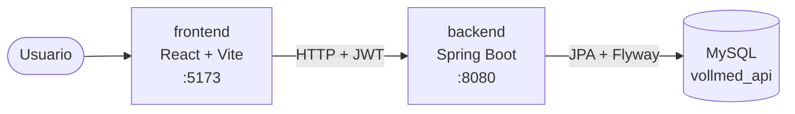

# MediApi

Plataforma web para reservar y gestionar citas médicas. Tiene una API REST en Spring Boot y una aplicación web en React, las dos en un solo repositorio (monorepo).

## Estructura

| Carpeta | Qué contiene | Se abre con |
|---|---|---|
| [`backend/`](backend/) | API REST: Spring Boot 4, Java 21, MySQL, Flyway, Spring Security + JWT, Swagger | IntelliJ IDEA |
| [`frontend/`](frontend/) | Aplicación web: React 19, TypeScript, Vite, Tailwind CSS | WebStorm |
| [`docs/`](docs/README.md) | Decisiones de arquitectura, problemas resueltos e ideas | — |



## Requisitos

- Java 21 (Eclipse Temurin)
- Node.js 24 y npm
- MySQL 8 con una base de datos `vollmed_api`

## Cómo levantarlo en local

### 1. Backend: abrir `backend/` en IntelliJ IDEA

Copia `backend/.env.example` como `backend/.env` y completa los valores, sin comillas ni tildes (el archivo explica el formato). El backend lee ese archivo al arrancar, así que no hace falta configurar nada en IntelliJ. Git ignora `.env`, así que tus valores no se suben.

| Variable | Para qué |
|---|---|
| `DB_PASSWORD` | Contraseña del usuario de MySQL |
| `JWT_SECRET` | Secreto para firmar los tokens JWT: una cadena larga y aleatoria |
| `ADMIN_EMAIL` | Correo del administrador inicial |
| `ADMIN_PASSWORD` | Contraseña del administrador inicial, de al menos 8 caracteres |

Si no existe ningún administrador, el backend lo crea al arrancar con `ADMIN_EMAIL` y `ADMIN_PASSWORD`. Después esas dos variables ya no hacen falta. Más detalles en el [ADR 0002](docs/adr/0002-admin-inicial-por-variables-de-entorno.md).

También puedes definirlas como variables de entorno, en Windows o en IntelliJ (*Run → Edit Configurations → Environment variables*). Si una variable está en los dos sitios, gana la variable de entorno. Más detalles en el [ADR 0003](docs/adr/0003-credenciales-locales-en-env.md).

```bash
cd backend
./mvnw spring-boot:run
```

En PowerShell usa `.\mvnw spring-boot:run`. Al arrancar, Flyway crea las tablas. La documentación interactiva de la API queda en <http://localhost:8080/swagger-ui.html>.

### 2. Frontend: abrir `frontend/` en WebStorm

Copia `frontend/.env.example` como `frontend/.env` y completa:

| Variable | Valor en local |
|---|---|
| `VITE_API_BASE_URL` | `http://localhost:8080` |
| `VITE_RECAPTCHA_SITE_KEY` | Tu clave pública de reCAPTCHA |

```bash
cd frontend
npm ci
npm run dev
```

La aplicación queda en <http://localhost:5173>. El backend solo acepta peticiones (CORS) desde ese origen.

## Flujo de trabajo con git

- `main` siempre debe compilar y funcionar.
- Cada cambio va en su propia rama y entra a `main` con un Pull Request. Prefijos de rama: `feature/`, `fix/`, `refactor/`, `test/`, `docs/`, `chore/`.
- Los mensajes de commit siguen [Conventional Commits](https://www.conventionalcommits.org/es/) en español: `feat: ...`, `fix: ...`, `refactor: ...`, `test: ...`, `docs: ...`, `chore: ...`.

## Documentación

Las decisiones, los problemas que aparecieron con su solución y las ideas pendientes están en [`docs/`](docs/README.md).
